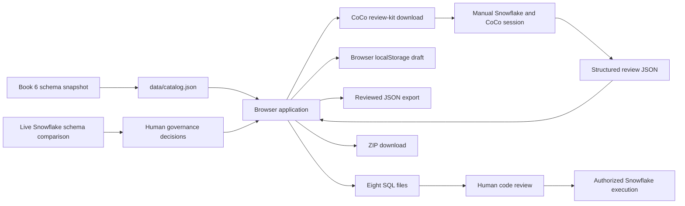

# Architecture and security

## Architecture

Governance Script Studio is a buildless static application.

There is no application server, API, runtime database or Snowflake connector.

## Components

| Component | Responsibility |
|---|---|
| `index.html` | Accessible seven-step workflow and download UI |
| `styles.css` | Responsive visual design |
| `app.js` | State, validation, SQL rendering, local drafts, import/export and ZIP encoding |
| `data/catalog.json` | Physical schema snapshot for `DEV.RAW` |
| `netlify.toml` | Static publish configuration and response headers |

## Data flow

1. The browser fetches `data/catalog.json` from the same origin.
2. The selected table initializes a browser-local configuration.
3. User decisions update in-memory state and `localStorage`.
4. Optionally, the browser renders a CoCo review kit for manual Snowflake execution and imports the returned JSON as unapproved recommendations.
5. Export serializes the reviewed state as JSON.
6. Generation renders SQL strings in memory.
7. Downloads use browser `Blob` URLs.
8. ZIP creation uses a local, uncompressed ZIP encoder; no third-party CDN is used.

## Network behavior

After the static assets are loaded, the application makes no external requests. It does not transmit configurations, table names or decisions to GitHub, Netlify, OpenAI, Snowflake or any analytics service.

The optional CoCo workflow is a manual file handoff controlled by the user. The browser does not initiate or observe the Snowflake/CoCo session.

Netlify naturally receives standard web-server request metadata when serving the static site. No analytics integration is included.

## Stored browser data

Drafts are stored under table-specific `localStorage` keys. This is convenient but not a governance evidence store.

- Drafts remain on the device/browser profile.
- Clearing site data deletes them.
- Other scripts running on the same origin could read them.
- Do not enter credentials, PII values or secrets.
- Export reviewed JSON and store it in the approved repository/workflow.

## Trust boundaries

### Catalogue facts

Catalogue fields are untrusted snapshots until compared with the live schema. The application HTML-escapes catalogue values before displaying them.

### Human decisions

Human input is trusted only after review. The application provides structural validation, not business approval.

### CoCo recommendations

Imported CoCo JSON is untrusted automation output. The importer binds it to the selected table and contract version, whitelists evidence and tag fields, accepts only bounded aggregate expressions, records warnings and resets every human confirmation. It can prefill review fields but cannot satisfy approval gates.

### Generated SQL

Generated SQL crosses the largest trust boundary: it is intended for privileged execution. The application escapes SQL string literals and normalizes one-line comments. Role names and row-policy names are validated as identifiers.

Two inputs intentionally permit SQL expressions:

- `baseline.extra_aggregates` in imported JSON;
- de-identification acceptance expressions.

These exist because aggregate logic is table-specific. Treat them as source code and review them accordingly.

## Policy limitations

The frontend assumes existing shared objects consistent with the runbook pattern:

- `GOVERNANCE.TAGS.GDF_PII`
- `GOVERNANCE.TAGS.CDE`
- `GOVERNANCE.TAGS.PII_DERIVED`
- source/layer/retention tags
- `GDF_MASK_STRING`, `GDF_MASK_DATE`, `GDF_MASK_TS`, `GDF_MASK_NUMBER`, `GDF_MASK_FLOAT`

The frontend does not inspect these policy bodies. A tag on an unsupported type, such as Boolean or Variant when no matching policy exists, does not provide masking. The UI blocks the five known shared masking tiers on unsupported types.

## Privileged commands

Generated scripts may contain:

- `USE ROLE ACCOUNTADMIN`
- grants on tables or the account
- tag assignments
- DMF creation and attachment
- row-access policy attachment
- comments visible to metadata consumers

Generation is not authorization. Execute only through approved change management.

## Security headers

`netlify.toml` currently sets:

- `X-Content-Type-Options: nosniff`
- `Referrer-Policy: no-referrer`
- restrictive camera, microphone and geolocation permissions

A strict Content Security Policy is not currently set. If added, permit only same-origin scripts/styles/data and Blob downloads used by the application.

## Secrets

This repository requires no secrets. Do not configure Snowflake passwords, API keys or personal access tokens as frontend environment variables; frontend variables are public to visitors.

## Dependency posture

The application uses browser APIs and no third-party packages. This removes package-install and CDN supply-chain dependencies. Browser compatibility should still be tested after changes to APIs such as `Blob`, `TextEncoder`, `localStorage` or clipboard access.
